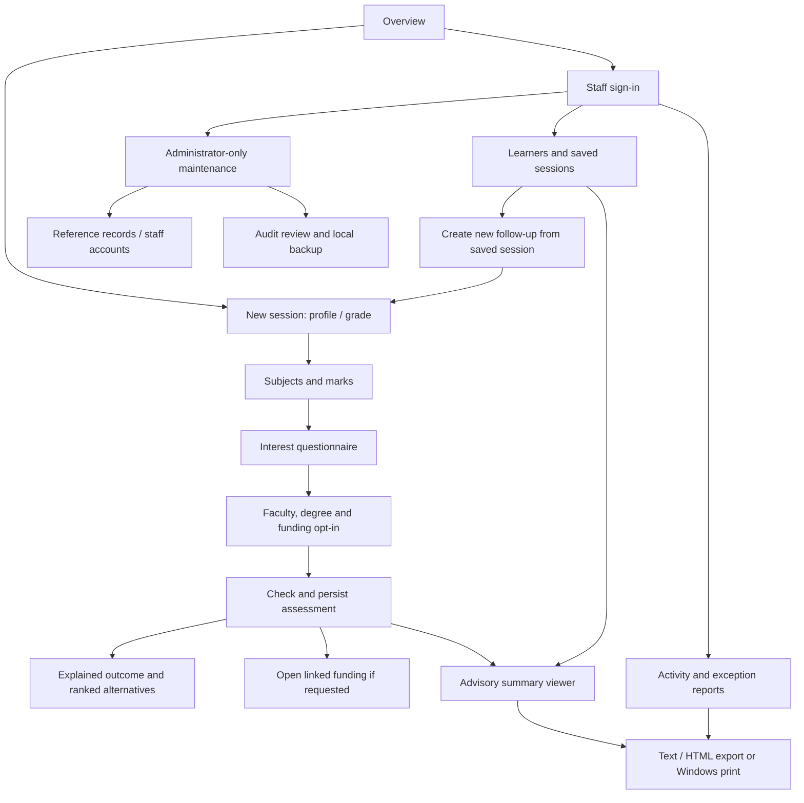
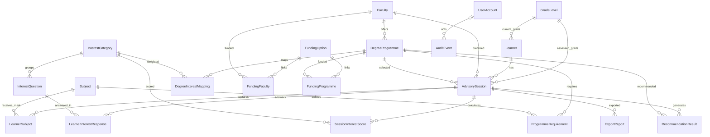

# Future Path — Systems Design Specification

Implementation version 1.1 (LocalDB migration) • INF2011S • Technical draft for team review

Team members, student numbers, responsibilities, actual milestone dates and signatures must be completed by the team. This document describes the implemented design and must be reconciled with any previously submitted specification. It does not assert that Windows manual tests or a marking assessment have taken place.

## 1. Introduction

### 1.1 Overview

Future Path translates the supplied student advising case study into a standalone desktop system. This specification explains its scope, screens, object interactions, classes, relational data model, reports, controls and test approach. It provides a blueprint for understanding and maintaining the implementation and a basis for comparing test outcomes against the stated requirements.

### 1.2 Context and scope

South African Grade 11 and 12 learners need early guidance about the relationship between school results, interests, degree requirements and possible funding. Learners capture a profile, subjects and marks, complete an interest questionnaire, select one degree, and receive an explained advisory result, alternatives and optional funding information. They can export a summary for a parent, teacher or advisor.

Career Advisors authenticate to retrieve saved sessions, create follow-up assessments and generate reports. System Administrators authenticate to maintain reference data and staff accounts, review the audit trail and back up the database. Application submission, official admission decisions, online funding applications, live university information, parent accounts, multilingual support, web hosting and external AI are outside this iteration.

### 1.3 Assumptions and constraints

- C# / .NET 10 Windows Forms, Windows 10/11 x64, one user and one application instance per local database.
- SQL Server Express LocalDB is the local relational database server on the same Windows machine. The database is FuturePathStudentAdvisingSystem, prepared explicitly with the Database scripts. No web server, cloud runtime or internet connection is needed for advising.
- Three tiers: Presentation (`FuturePath.Desktop`), Business Logic (`FuturePath.Business`), and Data Access (`FuturePath.Data`). The composition root wires them together; business contracts are interfaces.
- No ChatGPT, Gemini, Copilot, external AI, online API or internet feature is part of the running application. All advice is calculated locally from stored rules and questionnaire data.
- Grade 11 results are provisional. Sample programmes and funding must be verified with official sources. A near match is not an assertion that entry requirements are met.
- Names and contacts are optional to minimise personal information. Grade is required. No ID number, date of birth or household income is collected.
- Personal profile details are created with an assessment. A staff follow-up preserves identity and creates a new assessment with changed marks, grade, programme or responses. Previous results remain immutable.
- An explicit confirmation distinguishes missing subjects from an incomplete list. If the list is incomplete, the system returns More Information Needed rather than assuming a missing required subject is not taken.
- Questionnaire answers are a 1–5 Likert scale. All active questions must be answered for a complete assessment. At least eight are seeded.
- A missing mandatory subject or mandatory mark shortfall greater than five points means Not Currently Eligible. A shortfall of one to five points is Possible Match. Strong Match additionally requires interest alignment ≥60%.
- Funding availability is evaluated using the computer's current local date, with the closing date inclusive. Sessions and report timestamps are recorded in UTC. Funding records can therefore change between an assessment and a later export; the report generation date is explicit.
- Historical scores and explanations are stored. Reference labels, learner identity and current open funding are read at report time; editing a reference label may change a historical report's displayed name, not its saved scores. Original exported documents are not overwritten automatically.
- Local files are protected by the Windows account. Application authorization does not encrypt the database or defend against direct filesystem access.

## 2. User interface and dialogue design

### 2.1 Interface flow



The main window hosts all learner/staff/report/editor UserControls. AdvisingPage uses retained panels instead of selectable tabs, with Back/Next validation and a clear step indicator. Summary preview stays in the shell. The sidebar is rebuilt after authentication. Authorization is also checked in the business services, so hiding buttons is not the security boundary. A guest can export only sessions created in the current workspace. Signing out clears workspace ownership and screen content. Navigating away from unsaved entries asks for confirmation.

### 2.2 Screen standards

Segoe UI at 10pt is the default, with larger headings. A navy sidebar identifies navigation; teal buttons indicate the primary action. White cards on a light background group related information. Labels appear above inputs, required fields use `*`, dates use Windows date controls, marks use numeric controls, and reference fields use dropdown lookups. Outcomes are always labelled in text; colour alone does not convey meaning.

Forms are DPI-aware, have a minimum size, and scroll when content exceeds the available space. Standard controls support keyboard focus and Tab navigation. Inputs have accessible names. Dialogs use consistent Save/Cancel actions. Failed validations explain the field or rule that needs attention; destructive navigation and subject removal use confirmations. Saved assessments become read-only, and follow-ups preserve the previous session.

### 2.3 Detailed screen layouts and data

The supplementary screen wireframes show the implemented structure; they are design drawings, not screenshots. Input is marked I, retrieved data R, calculated output C and persisted output P.

| Screen | Main controls / data | Actions and output |
|---|---|---|
| Overview | Brand/sidebar, learner instructions, offline status, advisory/privacy disclaimer (R) | Start session or staff sign-in |
| Profile | Name/alias, school, province, email, phone (I, optional); Grade 11/12 lookup (I, required) | Next validates the page; Back retains input; identity saved only with confirmed assessment |
| Subjects and marks | Active subject dropdown (R→I); numeric 0–100 mark (I); selected-subject grid; all-subjects confirmation (I) | Add, update selected, remove selected, continue; reject duplicates |
| Interests | Active question text/category (R); one 1–5 or unanswered choice per question (I) | Continue; normalized category scores calculated on assessment (C) |
| Programme | Faculty and filtered active degree lists (R→I); description and requirements (R); funding opt-in (I) | Check eligibility and save; report incomplete information when necessary |
| Outcome | Outcome, weighted score, interest alignment, requirement checks and gaps (C→P) | Review result and start new session from sidebar |
| Alternatives | Up to five eligible/near-match degrees, outcome and score (C→P) | Why this alternative? shows detailed reasons; no guaranteed admission |
| Funding | Opt-in state (P); relevant active/open records, type, eligibility, documents, deadline and contact (R) | Guidance only; no web request or application submission |
| Advisory viewer | Profile, academic/interest data, results, alternatives, optional funding, dates, rule version and disclaimer (R/P) | Save .html/.txt; Print/PDF; Back to source; Finish to overview |
| Staff sign-in | Username and masked password (I), show-password checkbox | Authenticate; role is loaded from database, never selected by the user |
| Advisor | Search name/degree/session # and UTC dates (I); session grid and selected explanation (R) | View summary; create follow-up; reports |
| Administrator | Reference-area selector, grid, typed editor with lookup/numeric/date/text/boolean fields (R/I) | Add, edit, activate/deactivate; account maintenance; audit; backup |
| Reports | Inclusive from/to dates, optional search term (I); report cards | Generate activity/exception report, display, export or print |

## 3. Design sequence diagrams

### 3.1 Check eligibility and generate advisory outcome

```mermaid
sequenceDiagram
  actor Learner
  participant UI as AdvisingPage (Presentation)
  participant Service as AdvisingService (Business)
  participant Engine as RecommendationEngine (Business)
  participant Store as SqlServerStore (Data)
  participant DB as SQL Server LocalDB
  Learner->>UI: Submit profile, marks, answers and degree
  UI->>Service: Assess(AdvisoryInput)
  Service->>Store: GetLookup / GetQuestions / GetProgrammes
  Store->>DB: Parameterized reads
  DB-->>Store: Reference data and rules
  Store-->>Service: Typed domain objects
  Service->>Service: Validate ranges, duplicates, grade and references
  alt Invalid input
    Service-->>UI: ValidationException with actionable message
  else Valid input (possibly incomplete)
    Service->>Engine: Assess(input, programmes, questions, now)
    Engine->>Engine: Required/OR subject checks, gap analysis and scoring
    Engine-->>Service: AdvisorySession with outcome and alternatives
    Service->>Store: SaveSession(session)
    Store->>DB: BEGIN: learner, session, marks, answers, scores, results; COMMIT
    DB-->>Store: New session ID
    Store-->>Service: ID
    Service->>Service: Register current workspace ownership
    Note over Store,DB: Creation audit commits with the assessment
    Service-->>UI: Saved AdvisorySession
    UI-->>Learner: Explained result; funding if requested; summary action
  end
```

Domain validation happens before writes. A single transaction saves the complete assessment; a failed write rolls it back. The assessment creation audit is included in the same transaction as the complete assessment. A high overall score cannot override a mandatory subject gap.

### 3.2 Generate alternative recommendations

```mermaid
sequenceDiagram
  participant UI as AdvisingPage
  participant Service as AdvisingService
  participant Store as SqlServerStore
  participant DB as SQL Server LocalDB
  participant Engine as RecommendationEngine
  UI->>Service: Assess(input)
  Service->>Store: GetProgrammes(activeOnly=true)
  Store->>DB: Active degrees in active faculties + requirements + mappings
  DB-->>Store: Stored programme rules
  Store-->>Service: List<DegreeProgramme>
  Service->>Engine: Assess(input, programmes, questions, now)
  loop Each active degree except selected
    Engine->>Engine: Evaluate subjects, OR groups, marks, average, interests, preference
    Engine->>Engine: Keep StrongMatch or PossibleMatch only
  end
  Engine->>Engine: Sort Strong first, then score descending, then name; take five
  Engine-->>Service: Session containing selected result and alternatives
  Service->>Store: SaveSession including ranked RecommendationResult rows
  Store->>DB: Persist selected rank 0 and alternatives ranks 1..5
  Service-->>UI: Explained, ranked alternatives
```

Alternative eligibility uses the same rules as the selected degree. More Information Needed and Not Currently Eligible programmes are not offered as suitable alternatives. An empty result explains that more information or advisor assistance may be needed.

## 4. Design class model

```mermaid
classDiagram
  class IFuturePathStore {
    <<interface>>
    +GetProgrammes(bool) List~DegreeProgramme~
    +GetQuestions(bool) List~InterestQuestion~
    +GetFunding(int, DateOnly) List~FundingOption~
    +SaveSession(AdvisorySession, int?) int
    +GetSession(int) AdvisorySession
    +FindSessions(DateOnly, DateOnly, string) List~SessionSummary~
    +SaveReference(string, int, values) int
    +Backup(string) void
  }
  class IClock { <<interface>>
    +UtcNow DateTime
    +Today DateOnly
  }
  class AdvisingPage { -services AppServices
    -marks BindingList~SubjectMark~
    +HasUnsavedInput bool
    ~SubmitAssessment() void
  }
  class AdvisingService { -store IFuturePathStore
    -access AccessSession
    -clock IClock
    +Assess(AdvisoryInput) AdvisorySession
    +Load(int) AdvisorySession
    +Search(DateOnly, DateOnly, string) List~SessionSummary~
  }
  class RecommendationEngine {
    +Evaluate(AdvisoryInput, DegreeProgramme, questions) Recommendation
    +Assess(input, programmes, questions, DateTime) AdvisorySession
    +CalculateInterests(responses, questions) Dictionary
  }
  class AdvisoryInput { +Learner LearnerProfile
    +DegreeId int
    +PreferredFacultyId int
    +SubjectsComplete bool
    +FundingRequested bool
    +Marks List~SubjectMark~
    +Responses List~InterestResponse~
  }
  class LearnerProfile { +Id int
    +Name string
    +Grade int
    +School string
    +Province string
    +Email string
    +Phone string
  }
  class SubjectMark { +SubjectId int
    +SubjectName string
    +Mark decimal
  }
  class InterestResponse { +QuestionId int
    +Score int
  }
  class DegreeProgramme { +Id int
    +FacultyId int
    +Name string
    +Active bool
    +MinimumAverage decimal
    +Requirements List~ProgrammeRequirement~
    +Interests List~InterestWeight~
  }
  class ProgrammeRequirement { +SubjectId int
    +MinimumMark decimal
    +Mandatory bool
    +AlternativeGroup int
    +Note string
  }
  class InterestWeight { +CategoryId int
    +Weight decimal
  }
  class AdvisorySession { +Id int
    +CreatedUtc DateTime
    +RuleVersion string
    +Input AdvisoryInput
    +Selected Recommendation
    +Alternatives List~Recommendation~
    +InterestScores Dictionary
  }
  class Recommendation { +DegreeId int
    +Outcome AdvisoryOutcome
    +SubjectScore decimal
    +MarkScore decimal
    +InterestScore decimal
    +PreferenceScore decimal
    +OverallScore decimal
    +Explanation string
  }
  class AccessSession { -ownedSessions HashSet~int~
    +UserId int?
    +Role UserRole
    +RequireStaff() void
    +RequireAdmin() void
    +RequireSession(int) void
    +SignOut() void
  }
  class AuthenticationService { +Login(string, string) void
    +ChangePassword(string, string) void
    +SaveUser(int, string, UserRole, bool, string) void
  }
  class PasswordHasher { +Hash(string) string
    +Verify(string, string) bool
  }
  class MaintenanceService { +Rows(string) List~ReferenceRow~
    +Save(string, int, values) int
    +Backup(string) void
  }
  class ReportService { +Summary(int) ReportDocument
    +Activity(DateOnly, DateOnly, bool, string) ReportDocument
    +Export(ReportDocument, string) void
  }
  class SqlServerStore { +DatabaseName string
    +Initialize() void
  }
  class AppForm
  class MainForm
  AppForm <|-- MainForm
  IFuturePathStore <|.. SqlServerStore
  AdvisingPage --> AdvisingService
  AdvisingService --> IFuturePathStore
  AdvisingService --> IClock
  AdvisingService --> AccessSession
  AdvisingService --> RecommendationEngine
  AuthenticationService --> PasswordHasher
  AuthenticationService --> AccessSession
  AuthenticationService --> IFuturePathStore
  MaintenanceService --> AccessSession
  MaintenanceService --> IFuturePathStore
  ReportService --> AccessSession
  ReportService --> IFuturePathStore
  AdvisoryInput "1" *-- "1" LearnerProfile
  AdvisoryInput "1" *-- "1..*" SubjectMark
  AdvisoryInput "1" *-- "0..*" InterestResponse
  DegreeProgramme "1" *-- "1..*" ProgrammeRequirement
  DegreeProgramme "1" *-- "1..*" InterestWeight
  AdvisorySession "1" *-- "1" AdvisoryInput
  AdvisorySession "1" *-- "1..6" Recommendation
```



`+` denotes public, `-` private and `~` internal visibility. Interfaces permit substitutable repositories and clocks. Concrete services are composed rather than inherited unnecessarily. `AppForm` provides shared form behaviour. `AccessSession` has private identity setters; successful authentication alone establishes staff identity. Entity objects carry strongly typed domain data between tiers. `ReportComposer` renders a document independently from storage, and `ReportDocument.ToHtml()` encodes user text.

Supplementary classes are `InterestQuestion` (Id, CategoryId, Category, Text), `FundingOption` (Id, Name, Type, Eligibility, Documents, ClosingDate, Contact, Sample), `UserAccount` (Id, Username, PasswordHash, Role, Active, FailedAttempts, LockedUntilUtc), `SessionSummary` (report/search projection), and reference metadata classes `ReferenceDefinition`, `ReferenceField` and `ReferenceRow`. The concrete schema and complete attribute types are documented in Data-Dictionary.md.

## 5. Relational model and data dictionary

The complete ERD is provided as `diagrams/ERD.svg` and in the Word specification. Database/02_CreateTables.sql is authoritative. Every table has a primary key; child records have enforced foreign keys. Lookup names are unique without case sensitivity. Marks and responses use composite keys to prevent per-session duplicates.



The design is in 3NF: learner and reference data are stored once; no subject list, answer list or funding link is stored in a repeated text field. Many-to-many relationships use junction tables. Requirement IDs determine their degree, subject and threshold. Session facts determine marks, responses and calculated results for that assessment, rather than a learner's latest marks. Programme faculty is derived through DegreeProgramme, not copied into the session. PreferredFacultyId is an independent preference, not a duplicated derived faculty.

Session GradeId records grade **at the time of assessment**, while Learner.GradeId is the grade entered on profile creation; they can differ in a later follow-up. Stored recommendation scores, category scores and explanations are immutable assessment outputs with a RuleVersion, not recalculated current profile values. Export documents are file artifacts, with normalized export metadata. See Data-Dictionary.md for all keys, types, constraints and relationships.

## 6. Report design

All reports show title, generation time, criteria, results and the advisory disclaimer. Printed output adds page numbers. Display/export is available offline and never submits an application.

### 6.1 Learner Advisory Summary

Purpose: give one learner a shareable plan. Intended users: the learner, parent/teacher chosen by the learner, and authenticated staff. Source: saved learner/session, subject results, questionnaire category scores, recommendation rows and currently open linked funding if requested. Selection: exactly one authorized session. Sort: subjects alphabetically, interests descending, alternatives by stored rank. Calculations: overall captured average plus persisted component scores. Generated after assessment or staff review; displayed, text/HTML-exported or printed.

```text
FUTURE PATH | LEARNER ADVISORY SUMMARY
Generated [UTC] | Session [#] | Assessed [UTC] | Rule version
Learner [name/anonymous] | Grade [11/12] | School / Province
Selected [programme] ([faculty]) | Outcome [text] | Score [%]
Subjects and marks [one row each] | Overall captured average
Interest categories [category / %]
Explanation and improvement areas [met rules / explicit gaps]
Alternative programmes [name / outcome / score / explanation]
Funding [if requested: type / criteria / documents / date / contact]
Next steps [verify official criteria, consult advisor]
Preliminary guidance disclaimer | Privacy notice
```

### 6.2 Degree Interest and Eligibility

Purpose: identify patterns in advising demand and outcomes. Users: Career Advisor or Administrator. Source: AdvisorySession, Learner, DegreeProgramme, Faculty and selected RecommendationResult. Selection: inclusive UTC session-date range and optional literal search by learner/programme/session ID. Sort: faculties/degrees by descending session count then name; details by learner and date. Calculations: session count, distinct learners, counts by outcome/faculty/degree and funding-request count. Used before guidance meetings or planning; display/export/print.

```text
FUTURE PATH | DEGREE INTEREST AND ELIGIBILITY REPORT
Generated [UTC] | Dates [from..to] | Search [criteria]
Sessions [count] | Distinct learners [count]
Outcomes: Strong [n], Possible [n], Not eligible [n], Incomplete [n]
Most selected faculties [faculty / sessions]
Selected degrees [degree / total / each outcome count]
Funding requested [n] of [total] sessions
Session details [learner / grade / degree / outcome / score / reasons]
Session-count interpretation | Disclaimer | Staff privacy notice
```

### 6.3 Learners Not Currently Eligible Exception Report

Purpose: prioritize follow-up guidance. Users: Career Advisor or Administrator. Source and date/search criteria as above, restricted to Not Currently Eligible and More Information Needed. Sort by learner/date. Includes grade, programme, outcome, score, explicit missing-subject/mark/information reasons and assessed date. Totals count sessions and distinct learners. Display/export/print during follow-up planning. It does not label a learner permanently ineligible.

```text
FUTURE PATH | LEARNERS NOT CURRENTLY ELIGIBLE — EXCEPTIONS
Generated [UTC] | Filter [inclusive dates and optional search]
Sessions [n] | Distinct learners [n]
[#] Learner | Grade | Assessment date | Programme
Outcome [not eligible / more information] | Score
Reasons / gaps [specific next-action information]
No matching records [when empty]
Disclaimer | Staff privacy notice
```

## 7. Input/output standards and integrity controls

### 7.1 Input standards

Grade is 11/12 only. Optional names/schools have a 120-character limit; emails 150 and valid email syntax; phone 7–20 characters using digits and normal punctuation. Province uses a South African lookup. Marks accept 0–100 with decimal precision; subjects must be valid active lookups and unique per session. Questionnaire answers are integers 1–5 with one response per active question; unanswered questions are permitted only as an incomplete assessment. Dates use date controls. Funding types use a fixed lookup: Scholarship, Bursary, Financial aid, External funding, Merit award.

### 7.2 Built-in validation

Validation is duplicated appropriately at UI, business and database boundaries. The UI guides input; business services independently check grade, contact formats, references, marks, duplicate subjects/answers and response ranges; SQL Server LocalDB enforces referential integrity and ranges. Active programmes must have a mandatory requirement and an interest mapping, with active referenced subjects/faculty/questions. New programmes are initially saved inactive until configured. Optional requirements cannot accidentally substitute for mandatory requirements; positive OR groups explicitly express accepted alternatives.

### 7.3 Input integrity

SQL is parameterized, with an explicit whitelist for reference table/field identifiers. Unique constraints prevent duplicate lookup names, degree/subject requirements, degree/category mappings and funding links. Transactions save the complete session atomically. The UI confirms removal and navigation with unsaved changes. Administrative changes preserve historical sessions by deactivation rather than deletion. The application is single-user; it does not support simultaneous multiuser editing. Backup uses SQL Server BACKUP DATABASE WITH COPY_ONLY,CHECKSUM and RESTORE VERIFYONLY to a new .bak file.

### 7.4 Output integrity

Rules produce one of four labelled outcomes with reasons. Scores cannot conceal hard gaps. Required missing information takes precedence over a complete eligibility claim. Only active degrees in active faculties are recommended; only active, unexpired related funding is displayed. Reports include dates, disclaimers and sample warnings. HTML encodes learner-supplied text to prevent active markup. Export first writes a temporary file on the destination volume, then replaces the destination, avoiding truncation on a failed write. Export metadata is written after file creation. Saved results are not silently recalculated by subsequent reference maintenance.

## 8. Security and access design

| Capability | Learner workspace | Career Advisor | Administrator |
|---|---|---|---|
| Create assessment / view active reference options | Yes | Yes | Yes |
| Load/export assessment | Current workspace's own sessions | All saved sessions | All saved sessions |
| Search learner/session records | No | Yes | Yes |
| Activity/exception reports | No | Yes | Yes |
| Maintain reference data / accounts / backup / audit review | No | No | Yes |
| Change own staff password | No account | Yes | Yes |

Passwords use PBKDF2-SHA256, 210,000 iterations and unique 16-byte random salts; comparisons use constant-time verification. Passwords require 12–128 characters including a letter and digit. Five failed logins lock the account for five minutes. User role is retrieved from the account after successful authentication. Account listings do not expose password hashes, and audit events do not contain passwords. The current administrator cannot deactivate or demote itself. Guests cannot elevate their role by selecting a role in the UI.

Every privileged business entry point calls RequireStaff/RequireAdmin; session reads/exports call RequireSession. Hiding navigation is an additional usability measure. Authenticated single-user staff are trusted with local advising records; protect the Windows login, exported files and backups. Data encryption and network identity providers are outside this iteration.

## 9. Recommendation rules and scoring

For each independent mandatory requirement, or mandatory OR group treated as one requirement:

- Subject coverage is 100 if an accepted subject has a mark, otherwise zero.
- Mark match is `min(100, entered / required × 100)`, using the best available OR choice by mark-minus-minimum margin. A zero threshold scores 100 when the subject is present.
- Subject and mark component scores are the average across mandatory groups. Optional helpful subjects do not reduce eligibility.
- Each question contributes `(answer − 1) × 25` to its category; multiple questions in one category are averaged.
- Degree interest alignment is the weighted mean of mapped category scores. Weights and mappings are stored in the database.
- Faculty preference is 100 for the preferred faculty, zero otherwise.
- Overall ranking is `0.35S + 0.35M + 0.25I + 0.05F`, rounded to two decimal places. Components are displayed rounded; internal precision is used for the final total.

Incomplete capture/questionnaire/configuration yields More Information Needed. Otherwise, missing mandatory subject or >5-point mandatory/average gap yields Not Currently Eligible; a 0–5-point shortfall or interest <60 yields Possible Match; otherwise Strong Match. Alternatives exclude the selected degree and retain only strong/possible matches, with Strong first, then descending overall score, then name, limited to five. An overall-average rule includes all captured subjects, including Life Orientation, when configured; no unofficial national APS formula is implied.

## 10. Implementation and ownership plan

This reflects the implemented dependency order. Actual team ownership and dates must be entered before submission; no student contribution or approval is invented.

| Order | Activity / deliverable | Dependency | Suggested responsibility |
|---|---|---|---|
| 1 | Requirements, constraints, screen/sequence/class/ERD/report design | Case study and Part 1 | Whole team; named reviewers to be recorded |
| 2 | Normalized schema, keys/checks and sample data | Approved data design | Database lead, with peer review |
| 3 | Domain models, recommendation engine, validation and tests | Rules and data contracts | Business-logic lead |
| 4 | Repository, transactional persistence, authentication and audit | Schema and interfaces | Data/security lead |
| 5 | Learner form workflow and result/alternative/funding integration | Services and stored data | Presentation lead |
| 6 | Advisor, maintenance, accounts, reports and export/print | Authorized services | UI/report lead |
| 7 | End-to-end integration, case-study outcomes, integrity/security checks | All components | Cross-review by each member |
| 8 | Windows layout/printing/offline acceptance, packaging, demo rehearsal | Green automated tests | Whole team |

Milestones: reproducible database; passing required outcomes; complete learner workflow; complete staff/report workflow; green tests; Windows acceptance evidence; final source/package/specification review. Record any deviation from the submitted design, especially the controlled SQLite-to-LocalDB migration, explicit OR requirements and interest-aware Strong Match rule.

## 11. Test plan

### 11.1 Environment

Development: .NET 10 SDK and Windows desktop development tooling on Windows 10/11 x64. A self-contained .NET release includes the .NET runtime but still requires separately installed SQL Server Express LocalDB. Cloud validation: Linux x64 compiles all projects with Windows targeting and executes pure rule/validation/report checks against exact JSON input fixtures. LocalDB integration tests explicitly skip on Linux; no other database provider substitutes for SQL Server. Windows-only tests and interactive acceptance must run on Windows.

### 11.2 Areas and approach

The portable suite executes shared profile/mark/question validation, eligibility boundaries, exact Part B outcomes, alternative ranking, report composition/encoding, password hashing and guest entry restrictions. The ported Windows LocalDB suite covers real funding queries, persistence, exports/metadata, database constraints, roles, login failures/lockout, password changes, maintenance, backups/restore and follow-ups. Tests use valid, invalid, boundary and exception cases and a fixed clock for time-dependent rules. Portable tests execute the real engine and validation/report composition, but do not claim persistence verification. The ported integration tests exercise real disposable LocalDB databases on Windows.

Four Windows tests construct form/editor/report controls, drive real learner capture/save, check Back/Next retention and absence of early writes, and verify that report/editor controls do not open a second main window. They are not claimed as executed in Linux. Manual Windows acceptance covers layout at 100/125/150% DPI, keyboard navigation, real printing/PDF, offline use, second-instance protection, save cancellation and filesystem failures.

### 11.3 Detailed cases, problem tracking and schedule

Test-Cases.md contains TC01–TC26 with initial state, test data and expected outcomes, including every mandatory Part B demonstration. Record actual outcomes, tester, date, evidence and defect IDs at the demonstration. Resolve defects with a reproduction, cause, change, affected-test rerun and closure evidence. Run portable tests after business changes, real LocalDB tests after data changes, Windows tests after UI changes, and manual acceptance before packaging/demonstration. Archive TRX output with the exact source revision/package checksum. Validation.md distinguishes passed automated checks from unrun Windows acceptance.

## 12. Relationship between design and implementation

The solution's project boundaries, source class names, schema and workflows implement this specification. Source is supplied for review and explanation. The original integrated starter contained placeholder actions and SQL Server scripts; the supplied reference provided working services over SQLite; this update retains those services and migrates persistence to SQL Server LocalDB. It preserves the required and additional learner records while computing recommendation results consistently rather than copying prewritten sample outcome rows.

The case-specific Part 1 instructions take precedence over unrelated hotel/booking/occupancy examples in the generic Word template. This specification includes the two required Future Path sequence diagrams and all three required reports. It is an implementation-aligned technical draft, not a substitute for team review, approval history or the Windows acceptance evidence still to be collected.

## LocalDB implementation update

Setup is explicit through Database/01–04 and SETUP-DEMO.cmd. Startup verifies SchemaVersion and never drops/recreates/seeds. SchemaVersion is metadata in addition to the 20 domain entities shown above. No existing SQLite data file was attached; those files are left untouched. The transferred reference inputs and generated SQL outcomes are retained under validation/reference and Database/03_SeedData.sql.

Only Microsoft.Data.SqlClient is a direct runtime package; the existing provider PKCS dependency is security-pinned. Existing xUnit/Test SDK packages remain test-only. See Dependencies.md. The implementation is not package-free. Detailed SQL types/limits now come from the generated Data-Dictionary.md and LocalDB schema, not the archived original SQLite diagram.

The learner's Next action requires the questionnaire answers, while the engine/service can still classify incomplete imported drafts as More Information Needed. Existing Yusuf/incomplete sample data is preserved. Reports add totals of sessions with stored subject/mark/questionnaire gap reasons. The prior source's 58 SQLite tests passed before migration; that baseline is not LocalDB verification. Current validation and Windows limitations are in Validation.md.
