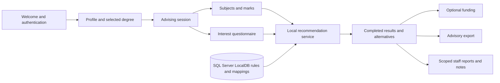

# Architecture and explainable local rules

## Existing architecture preserved

`Program → frmWelcome → frmLogin/frmCreateAccount → FPPage subclasses` remains the application entry path. There is one Windows Forms executable, one local SQL Server database, and a separate console test project. SDK cross-targeting was enabled for compilation on Linux; the actual application remains `net10.0-windows`.

| Layer | Classes/files | Responsibility |
|---|---|---|
| Presentation | `frmWelcome`, login/registration, `FPPage`, profile, marks, interests, recommendations, funding, advisor/admin/reports, `ManagementForm` | Controls, navigation, confirmation, displaying errors/results and selecting export paths. No SQL statements. |
| Business logic | `Validation`, `ReferenceDataValidation`, `RecommendationService`, `AdvisingWorkflow`, `ReportService` | Profile/mark/question validation, local scoring, coordinating a session, composing report text. |
| Data access | `UserAccountDAL`, `AdvisingDAL`, `AdminDAL`, `ReportDAL`, existing degree/grade/subject DAL, internal `SqlStore` | Parameterised SQL, transactions, mapping records, live active-role/ownership/assignment checks. |
| Models | `DegreeProgramme`, `LearnerProfile`, `AdvisingRecord`, record types in `AdvisingModels`, management metadata | Plain data shared across layers. |
| Security | `Roles`, `AppSession`, `AccessPolicy`, `PasswordHasher` | Session identity, entry permissions and password hashing. |

`SqlStore` is internal; forms cannot use its generic SQL helpers. `AdminDAL` selects SQL identifiers exclusively from fixed metadata definitions; only field values are parameters. SQL keys and foreign-key/unique/check constraints provide integrity beyond UI validation. Batch replacements for marks/responses and result completion use SQL transactions and roll back when an operation fails. The application is single-user as required by the overall guidelines; it does not implement multi-user cloud concurrency.

Existing `Form1/2/3` files and the obsolete insert-only `LearnerProfileDAL` are retained as historical starter material but excluded from compilation. Root `Presentation` contains uncompiled handoff prototypes; do not copy them into the executable. The baseline Git commit preserves the uploaded project. Active branded pages are in `FuturePathStudentAdvisingSystem/Presentation`.

## OOP demonstrated

- **Encapsulation:** `AppSession` exposes read-only identity state; `AdvisingWorkflow.Current` can be replaced only through workflow methods. Database helpers are internal.
- **Abstraction:** the UI calls operations such as `SaveMarks`, `Complete` and `Summary` rather than implementing scoring or SQL.
- **Inheritance:** login/welcome/registration derive from `BrandedForm`; functional pages derive from `FPPage`; profile read information derives from `LearnerProfile`.
- **Polymorphism:** Welcome holds a base `FPPage` and displays the selected derived page; WinForms dispatches inherited control/form behavior. No unnecessary custom interface hierarchy is added just for marking.
- **Composition:** forms contain field controls/cards/grids; `AdvisingRecord` contains marks and questionnaire responses; the workflow composes DAL and rule-engine operations.
- **Separation of concerns:** recommendation calculation is a pure class, independently executable in portable tests. DataTables are used for generic reference management and report projections rather than unnecessary entities for every lookup.

## Eligibility and scoring

All academic thresholds come from `ProgrammeRequirement.MinimumMark`. No APS scale, university acceptance probability, universal average, or arbitrary minimum subject count is invented.

A mandatory ungrouped requirement is a gate. Requirements sharing a nonempty `AlternativeGroup` are one OR gate. This explicit column is necessary because the starter's `IsMandatory=0` mixed optional recommendations with accepted alternative subjects. The migration groups only rows explicitly marked `Sample alternative:` in their existing notes. An administrator must explicitly maintain groups for new data. Ungrouped optional recommendations are displayed through reference data but do not disqualify a learner or inflate the gate denominator.

For each gate:

- Subject score = 100 if an accepted subject has a captured mark, otherwise 0.
- Mark score = `min(1, mark/minimum) × 100`; a zero minimum is fully attained when that subject is present. For OR gates, take the best attainment among captured alternatives.
- Programme subject and mark components are the arithmetic mean across gates.

Question responses are 1–5. Convert to 0–100 with `(response − 1) × 25`, average within each category, then take the degree's weighted mean using its positive `DegreeInterestMapping.Weight`. Preferred faculty contributes 100 when it matches, otherwise 0.

`Overall = 0.30 × subject + 0.30 × mark + 0.30 × interest + 0.10 × faculty preference`, rounded to two decimals. These weights and a strong-interest threshold of **60/100** are team design assumptions, not official university rules. No score can override a missing academic requirement.

| Condition | Advisory outcome | Academic status |
|---|---|---|
| Subject list not confirmed complete, questionnaire incomplete, or rules/mappings missing | More Information Needed | Incomplete |
| Confirmed subject list lacks a mandatory subject/alternative gate | Not Currently Eligible | Not eligible |
| All gate subjects present but one or more marks below minimum | Possible Match (improvement guidance) | **Not eligible** |
| All minima met, interest below 60 | Possible Match | Eligible |
| All minima met, interest >=60 | Strong Match | Eligible |

The separate academic status prevents “Possible Match” being mistaken for admission eligibility. The below-minimum improvement outcome matches the case study's required Labeeqah example. Missing-information precedence prevents incomplete capture being treated as a confirmed absence. Inactive degrees are excluded. Ranking prioritises academically eligible programmes, then improvement candidates, then incomplete data, then confirmed missing-subject results; within each group sort by score and programme name. The selected degree is shown before alternatives in the screen/export, while alternative ranking is preserved.

Every explanation lists gate attainment or gaps, interest alignment, formula and disclaimer. Stored assessments are retained after completion; later changes to reference rules affect new sessions. Existing historic results are not silently recalculated during upgrade. Sample seed results are generated with the same production engine used by the application.

## Security and privacy

PBKDF2-SHA256: 600,000 iterations, random 16-byte salt, 32-byte derived key, versioned encoded hash and constant-time comparison. No plaintext login fallback exists. Hash verification bounds iterations and lengths. Login error messages do not distinguish unknown accounts from wrong passwords. This standalone university demo has no account lockout/recovery email service; the local database owner remains trusted.

Forms check roles on entry. Backend DAL operations independently recheck the database account's active role. Learner writes require ownership; advisor reads require `AdvisorUserID` assignment; admin operations require an active administrator. Revocation invalidates the next protected operation. Guests see only reference data and their memory-only inputs. Logout clears identity and working data. Plaintext legacy accounts are disabled instead of silently imported as trusted credentials.

The existing `UserAccount` table serves as the learner profile rather than adding duplicate learner accounts/tables. Grade and phone are persisted there; phone storage is widened to preserve future leading zeros. Already-lost leading zeros in old integer records cannot be reconstructed safely. Session data remains normalised in the starter's existing related tables. Advisor assignment and notes are additive schema changes justified by restricted advising and guidance requirements. Funding remains linked by the existing single-faculty column and programme join table; no unnecessary parallel FundingFaculty table is introduced.

## Data flow

